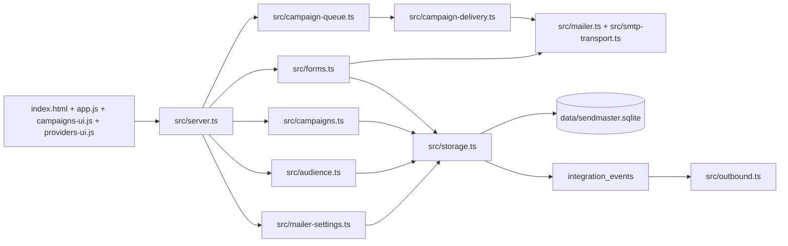

# Mapa visual — SendMaster-App
Atualizado: 2026-11-24

Módulo: [local-app.md](modules/local-app.md). Alvo de produto: [email-marketing.md](modules/email-marketing.md). O POST de revisão grava `campaign_messages`. O processo Node chama a fila, a sequência e a outbox a cada 15 segundos. Relatório em `src/tracking.ts`. Sequência em `src/sequences.ts`.
