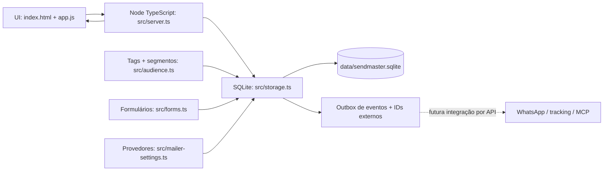

# Mapa visual — SendMaster-App
Atualizado: 2026-11-13

Módulo: [local-app.md](modules/local-app.md). O catálogo original e as configurações por workspace já existem, mas os adaptadores de envio/teste ainda não. Formulários capturam consentimento sem enviar confirmação. O servidor é local e loopback; esta arquitetura não representa uma implantação VPS.
